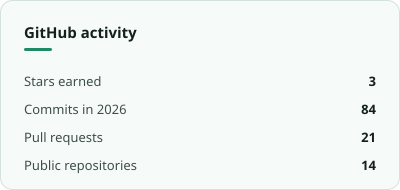
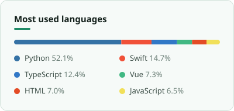

<picture>
  <source media="(prefers-color-scheme: dark)" srcset="assets/banner-dark.svg">
  
</picture>

Full-stack developer based in France. I build web apps and developer tools, mostly with TypeScript, Vue, React and Symfony, and lately a bit of native macOS with Swift. I also work a lot with Claude Code: MCP servers, RAG pipelines and agent skills.

 

## 🚀 Featured projects

| Project | What it is | Stack |
| --- | --- | --- |
| [**Portfolio**](https://github.com/Alexvolkihar/PortfolioAlexvolkihar) | My personal portfolio website. | HTML, CSS |
| [**Mochikao**](https://github.com/Alexvolkihar/mochikao) · [demo](https://mochikao.alexvolkihar.ovh) | Deterministic SVG avatars: any string becomes a cute, unique character. Ships for React, Vue, Svelte, Solid and as a web component. | TypeScript, SVG |
| [**Tsuta**](https://github.com/Alexvolkihar/Tsuta) | Native macOS Git client: commit graph, line-by-line staging, conflict resolution, interactive rebase, GitHub/GitLab reviews. | Swift, SwiftUI |
| [**Slides**](https://github.com/Alexvolkihar/slides) · [live](https://slides-seven-eta.vercel.app) | Presentation decks built with Slidev. | Vue, Slidev |

## 🧰 Tech stack

**Languages** &nbsp;      

**Front-end** &nbsp;     

**Back-end & data** &nbsp;       

**AI** &nbsp;     

**Tools** &nbsp;     

## 📊 GitHub stats

  <picture>
    <source media="(prefers-color-scheme: dark)" srcset="assets/stats-dark.svg">
    
  </picture>
  <picture>
    <source media="(prefers-color-scheme: dark)" srcset="assets/languages-dark.svg">
    
  </picture>

Cards regenerated daily by a GitHub Action from my public repositories.

### ✍️ Random dev quote

<picture>
  <source media="(prefers-color-scheme: dark)" srcset="https://quotes-github-readme.vercel.app/api?type=horizontal&theme=dark">
  
</picture>
